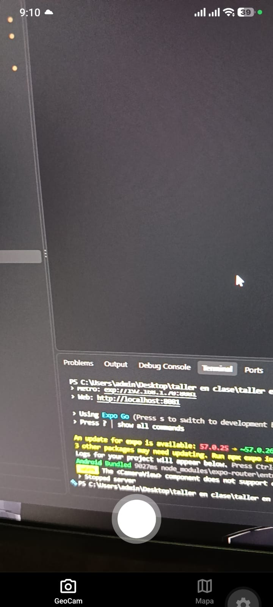
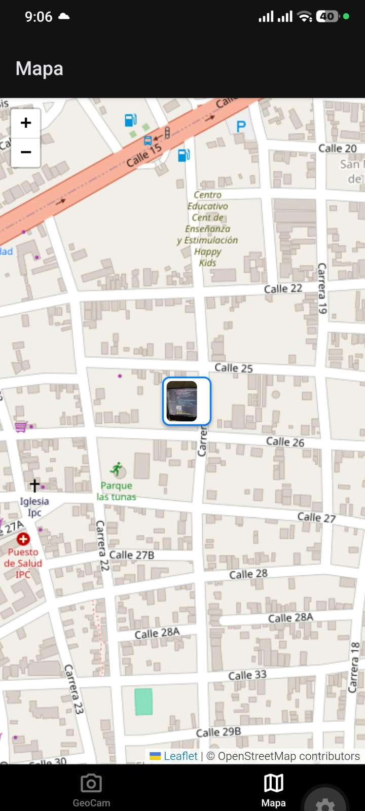

# GeoCam

App en Expo que toma fotos con la cámara, guarda su ubicación GPS y las muestra en un mapa
de OpenStreetMap. Los datos viven en **Supabase** (Postgres + Storage): las fotos se suben a
la nube y se ven desde cualquier dispositivo. En la Semana 7 se usaba SQLite con Drizzle
(ver `drizzle/` y `AI-LOG.md`).

## Cómo ejecutarlo

1. En el **SQL Editor** de tu proyecto de Supabase, ejecuta `supabase/schema.sql`
   (crea las tablas, las políticas de acceso anónimo y el bucket `photos`).
2. Copia `.env.example` a `.env.local` y pon la URL y la publishable key
   (Supabase › Project Settings › API).
3. Arranca la app:

       npm install
       npx expo start -c

## Arquitectura (por capas)

    Pantalla (app/)  ->  Hook (hooks/)  ->  Repositorio (db/repositories/)  ->  supabase-js (lib/supabase.ts)  ->  Supabase

Las pantallas **no importan nada de Supabase**: solo usan hooks.

| Capa | Archivos |
|------|----------|
| Pantallas | `app/(tabs)/geocam.tsx`, `fotos.tsx`, `mapa.tsx`, `app/foto/[id].tsx` |
| Hooks | `usePhotos`, `usePhotoList`, `usePhotoDetail`, `useAlbums`, `useCamera`, `useGeoLocation`, `useShake` |
| Repositorios | `db/repositories/photos.ts`, `albums.ts` |
| Tipos / refresco | `db/schema.ts` (filas -> tipos de la app), `db/changes.ts` (`useQuery` + `notifyChange`) |
| Cliente | `lib/supabase.ts` |
| Archivos | `services/photoFiles.ts` (sube la foto de caché al bucket `photos`) |
| Esquema | `supabase/schema.sql` |

## Modelo de datos

    albums                          photos
    ------                          ------
    id (PK)                         id (PK)
    name (UNIQUE)                   uri (URL pública en Storage)
    created_at                      storage_path (ruta en el bucket)
          ^                         latitude, longitude, accuracy (nullable)
          |  0..N                   source ('camera' | 'gallery')
          +-------------------------album_id (FK -> albums.id, ON DELETE SET NULL)
                                    note (nullable)
                                    favorite (boolean, def. false)
                                    created_at

- Al borrar un álbum sus fotos **no** se borran: quedan con `album_id = NULL`.
- Acceso anónimo con RLS abierta para el rol `anon`: válido para el taller, no para producción.

## Funciones

- Cámara y galería; la foto se sube a Supabase Storage y se borra junto con su registro.
- Pestaña **Fotos**: buscador por nota (`ilike`), filtro por álbum y por favoritas, creación de álbumes.
- Pantalla de foto: editar nota, favorita, mover de álbum y eliminar con confirmación.
- Agitar el teléfono ofrece borrar todas las fotos (con confirmación).

## Permisos

La app nunca pide permisos al abrirse. La cámara es obligatoria (`PermissionPrimer`); la
ubicación es opcional: si se niega, las fotos se guardan sin coordenadas. Con el permiso
bloqueado aparece el botón **Abrir Ajustes**.

| Concedido | Rechazado | Bloqueado |
|-----------|-----------|-----------|
| _agregar captura/GIF_ | _agregar captura/GIF_ | _agregar captura/GIF_ |

## Evidencia

